<div align="center">



<br/>

[](https://supunchathuranga.se/)
[](https://modelcontextprotocol.io)
[](https://konghq.com)

[](https://github.com/IamSupun/kong-rate-limiter-mcp-server/actions)
[](https://www.python.org/downloads/)
[](LICENSE)
[](https://github.com/IamSupun/kong-rate-limiter-mcp-server/stargazers)

**Tell your AI agent _"rate-limit /payments to 100 requests a minute"_ and it's done.**<br/>
A **Model Context Protocol (MCP) server** with **17 tools** that lets Claude, Cline or any MCP client manage Kong services, routes, plugins and rate limits through natural language.

[**Quick start**](#-60-second-quick-start) · [**Demo**](#-see-it-in-action) · [**Tools**](#-available-tools) · [**Architecture**](#️-architecture)

</div>

---

## 🎬 See it in action

<div align="center">

</div>

## ⚡ 60-second quick start

```bash
git clone https://github.com/IamSupun/kong-rate-limiter-mcp-server.git
cd kong-rate-limiter-mcp-server && ./venv.sh
export KONG_ADMIN_URL=http://localhost:8001
python -m kong_mcp_server.server        # serves MCP over SSE on :8080
```

Then point your MCP client at it, for example in Claude Desktop:

```json
{
  "mcpServers": {
    "kong-rate-limiter": { "type": "sse", "url": "http://localhost:8080/sse" }
  }
}
```

> ⭐ **If this saves you a trip to the Kong Admin API docs, a star helps others find it.**

## 🎯 Why This Project?

### The Problem
Modern API gateways like Kong are incredibly powerful but require:
- Deep knowledge of Kong's Admin API
- Manual configuration through REST API calls or CLI commands
- Complex JSON payloads for service, route, and plugin management
- Time-consuming troubleshooting and debugging
- Repetitive tasks that could be automated

### The Solution
This MCP server transforms Kong management by:
- **Natural Language Interface**: Configure Kong using plain English through AI agents like Claude
- **Intelligent Automation**: Let AI assistants handle complex Kong configurations automatically
- **Reduced Learning Curve**: No need to memorize Admin API endpoints or JSON schemas
- **Faster Development**: Prototype and deploy API configurations in seconds, not hours
- **Error Prevention**: AI-assisted validation and best practices application
- **Documentation as Code**: Conversational history serves as living documentation

### Real-World Use Cases

#### 1. **Rapid API Prototyping**
```
User: "Create a new service for my user API at https://api.example.com and add a route for /users"
AI Agent: Creates service, configures route, and confirms setup
```

#### 2. **Intelligent Rate Limiting**
```
User: "Add rate limiting to my payment API - 100 requests per minute per user"
AI Agent: Configures rate limiting plugin with appropriate scope and limits
```

#### 3. **Security Automation**
```
User: "Set up JWT authentication for all routes in the admin service"
AI Agent: Applies JWT plugin to service with recommended configuration
```

#### 4. **Troubleshooting**
```
User: "Why is my API returning 502 errors?"
AI Agent: Checks service health, route configuration, and plugin settings
```

#### 5. **Bulk Operations**
```
User: "Add CORS headers to all my public APIs"
AI Agent: Identifies public services and applies CORS plugin configuration
```

## 🌟 Key Features

### AI-Powered Kong Management
- **Conversational Interface**: Manage Kong through natural language conversations
- **Context-Aware Operations**: AI understands Kong concepts and relationships
- **Smart Defaults**: Intelligent suggestions based on best practices
- **Error Handling**: Helpful explanations and automatic recovery suggestions

### Comprehensive Kong Integration
- **Services Management**: Create, read, update, and delete Kong services
- **Routes Configuration**: Full CRUD operations for Kong routes
- **Plugin Administration**: Manage all Kong plugins with scope support
- **Rate Limiting**: Specialized tools for rate limiting configuration
- **Authentication Support**: Both Kong CE and EE authentication methods

### Developer Experience
- **FastMCP Framework**: Built on modern, efficient MCP SDK
- **SSE Transport**: Real-time Server-Sent Events communication
- **Docker Support**: Easy deployment with Docker and Docker Compose
- **Comprehensive Testing**: High test coverage with unit and integration tests
- **Extensive Documentation**: Clear guides and examples

## 🚀 Installation options

### Prerequisites
- Python 3.10 or higher
- Kong Gateway (Community or Enterprise Edition)
- Docker (optional, for containerized deployment)
- An MCP client (e.g., Claude Desktop, Cline for VS Code)

### Installation

#### Option 1: Virtual Environment (Recommended for Development)
```bash
# Clone the repository
git clone https://github.com/IamSupun/kong-rate-limiter-mcp-server.git
cd kong-rate-limiter-mcp-server

# Setup and activate virtual environment
./venv.sh

# Run the server
python -m kong_mcp_server.server

# In another terminal, run tests
pytest --cov=kong_mcp_server
```

#### Option 2: Docker (Recommended for Production)
```bash
# Pull from Docker Hub
docker pull shibbirmcc/kong-ratelimiter-mcp-server

# Run with host network
docker run --network host \
  -e KONG_ADMIN_URL=http://localhost:8001 \
  shibbirmcc/kong-ratelimiter-mcp-server
```

#### Option 3: Docker Compose
```yaml
version: '3.8'
services:
  kong-mcp-server:
    image: shibbirmcc/kong-ratelimiter-mcp-server
    ports:
      - "8080:8080"
    environment:
      - KONG_ADMIN_URL=http://kong:8001
      - KONG_TIMEOUT=30.0
    restart: unless-stopped
```

## 🔧 Configuration

### Environment Variables

#### Kong Configuration
```bash
# Kong Admin API URL (required)
export KONG_ADMIN_URL=http://localhost:8001

# Kong Community Edition Authentication
export KONG_USERNAME=admin
export KONG_PASSWORD=your-password

# Kong Enterprise Edition Authentication (alternative)
export KONG_API_TOKEN=your-api-token

# Additional Options
export KONG_TIMEOUT=30.0              # Request timeout (seconds)
export KONG_VERIFY_SSL=true           # SSL verification
```

#### Server Configuration
```bash
export FASTMCP_PORT=8080              # Server port (default: 8080)
export HOST=127.0.0.1                 # Server host (default: 127.0.0.1)
```

### MCP Client Configuration

#### Claude Desktop
Add to your Claude Desktop configuration:
```json
{
  "mcpServers": {
    "kong-rate-limiter": {
      "disabled": false,
      "timeout": 60,
      "type": "sse",
      "url": "http://localhost:8080/sse"
    }
  }
}
```

#### Cline (VS Code)
Add to your Cline MCP settings:
```json
{
  "kong-rate-limiter": {
    "command": "http://localhost:8080/sse",
    "args": [],
    "env": {}
  }
}
```

## 📚 Available Tools

### Service Management
- `kong_get_services` - Retrieve Kong services with filtering
- `kong_create_service` - Create new Kong service
- `kong_update_service` - Update existing service
- `kong_delete_service` - Delete service

### Route Management
- `kong_get_routes` - Retrieve Kong routes with filtering
- `kong_create_route` - Create new route
- `kong_update_route` - Update existing route
- `kong_delete_route` - Delete route

### Plugin Management
- `kong_get_plugins` - Get all plugins with filtering and pagination
- `kong_get_plugin` - Get specific plugin by ID
- `kong_get_plugins_by_service` - Get plugins scoped to service
- `kong_get_plugins_by_route` - Get plugins scoped to route
- `kong_get_plugins_by_consumer` - Get plugins scoped to consumer

### Rate Limiting
- `kong_create_rate_limiting_plugin` - Create rate limiting with all scopes (global, service, route, consumer)
- `kong_get_rate_limiting_plugins` - Retrieve rate limiting plugins with filtering
- `kong_update_rate_limiting_plugin` - Update rate limiting configuration
- `kong_delete_rate_limiting_plugin` - Delete rate limiting plugin

### Testing
- `hello_world` - Basic test tool for connectivity verification

## 🏗️ Architecture

```
src/kong_mcp_server/
├── server.py                    # Main MCP server with FastMCP
├── kong_client.py               # Kong Admin API HTTP client
├── tools_config.json            # Tool configuration and metadata
└── tools/                       # Modular tool implementations
    ├── basic.py                 # Basic utility tools
    ├── kong_services.py         # Service management
    ├── kong_routes.py           # Route management
    ├── kong_plugins.py          # Plugin management
    └── kong_rate_limiting.py    # Rate limiting operations
```

### Design Principles
- **Modularity**: Each tool category in separate module
- **Extensibility**: Easy to add new tools via JSON configuration
- **Type Safety**: Full type hints and validation
- **Error Handling**: Comprehensive error messages and recovery
- **Testing**: High test coverage with mocks and live tests

## 🧪 Testing

### Run Tests
```bash
# All tests with coverage
pytest --cov=kong_mcp_server --cov-report=term-missing

# Specific test suite
pytest tests/test_tools_kong_rate_limiting.py -v

# Integration tests (requires Kong instance)
RUN_LIVE_TESTS=true pytest tests/test_kong_integration.py
```

### Test Coverage
The project maintains high test coverage across all modules:
- Unit tests for all tools
- Integration tests with Kong
- HTTP client authentication tests
- Error handling and edge cases

## 🛠️ Development

### Adding New Tools

1. **Create tool module** in `src/kong_mcp_server/tools/`
```python
async def my_new_tool(param1: str, param2: int) -> dict:
    """Tool description for AI."""
    # Implementation
    return {"result": "success"}
```

2. **Add to tools_config.json**
```json
{
  "tools": {
    "my_new_tool": {
      "name": "my_new_tool",
      "description": "Description for AI agent",
      "module": "kong_mcp_server.tools.my_module",
      "function": "my_new_tool",
      "enabled": true
    }
  }
}
```

3. **Add tests** in `tests/`

4. **Restart server** - Changes are picked up automatically

### Code Quality
```bash
# Linting
flake8 src/ tests/

# Type checking
mypy src/

# Formatting
black src/ tests/
isort src/ tests/
```

## 📖 Usage Examples

### Example 1: Create Service and Route
```python
# Through AI agent conversation:
"Create a service named 'users-api' pointing to https://api.example.com/users,
then add a route for path /users"

# MCP Server executes:
# 1. kong_create_service with URL and name
# 2. kong_create_route with path and service reference
```

### Example 2: Configure Rate Limiting
```python
# Through AI agent:
"Add rate limiting to the payments service - allow 100 requests per minute per consumer"

# MCP Server executes:
# kong_create_rate_limiting_plugin with:
# - service_id: <payments-service-id>
# - config.minute: 100
# - config.policy: "local"
```

### Example 3: Troubleshoot Configuration
```python
# Through AI agent:
"Show me all plugins on the api-gateway service"

# MCP Server executes:
# kong_get_plugins_by_service with service_id filtering
```

## 🐳 Docker Deployment

### Using Docker Hub Image
```bash
# Basic deployment
docker run --network host \
  shibbirmcc/kong-ratelimiter-mcp-server

# With Kong authentication
docker run --network host \
  -e KONG_ADMIN_URL=http://localhost:8001 \
  -e KONG_USERNAME=admin \
  -e KONG_PASSWORD=secret \
  shibbirmcc/kong-ratelimiter-mcp-server

# Custom port
docker run --network host \
  -e FASTMCP_PORT=9000 \
  -e KONG_ADMIN_URL=http://localhost:8001 \
  shibbirmcc/kong-ratelimiter-mcp-server
```

### Building Locally
```bash
# Build image
docker build -t kong-mcp-server .

# Run
docker run --network host kong-mcp-server
```

## 🔍 Testing with MCP Inspector

```bash
# Install MCP Inspector
npm install -g @modelcontextprotocol/inspector

# Start server
python -m kong_mcp_server.server

# Test with inspector (new terminal)
mcp-inspector --transport sse --server-url http://localhost:8080/sse
```

### Manual API Testing
```bash
# Test tools/list endpoint
curl -X POST http://localhost:8080/sse/request \
  -H "Content-Type: application/json" \
  -d '{"jsonrpc": "2.0", "id": "1", "method": "tools/list"}'

# Test tool execution
curl -X POST http://localhost:8080/sse/request \
  -H "Content-Type: application/json" \
  -d '{
    "jsonrpc": "2.0",
    "id": "2",
    "method": "tools/call",
    "params": {
      "name": "kong_get_services",
      "arguments": {}
    }
  }'
```

## 🤝 Contributing

Contributions are welcome! Please:
1. Fork the repository
2. Create a feature branch
3. Make your changes with tests
4. Submit a pull request

## 📄 License

Apache 2.0 License - see [LICENSE](LICENSE) file for details

## 🙏 Acknowledgments

- Built with [FastMCP](https://github.com/jlowin/fastmcp) framework
- Designed for [Model Context Protocol](https://modelcontextprotocol.io/)
- Integrates with [Kong API Gateway](https://konghq.com/)

## 📞 Support

- **Issues**: [GitHub Issues](https://github.com/IamSupun/kong-rate-limiter-mcp-server/issues)
- **Documentation**: [Project Wiki](https://github.com/IamSupun/kong-rate-limiter-mcp-server/wiki)
- **Discussions**: [GitHub Discussions](https://github.com/IamSupun/kong-rate-limiter-mcp-server/discussions)

---

**Made with ❤️ for the API Gateway and AI community**

---

<div align="center">

**Built by [Supun Chathuranga](https://github.com/IamSupun), [Shibbir Ahmed](https://github.com/shibbirmcc) and [Mohamad Bahmani](https://github.com/Mohamad-Bahmani)**<br/>
<sub>Supun: [Website](https://supunchathuranga.se/) · [LinkedIn](https://www.linkedin.com/in/supunchathuranga-ai/) · [Blog](https://blog.supunchathuranga.se/)</sub>

⭐ Star the repo if you find it useful. Issues and PRs are welcome!

</div>
